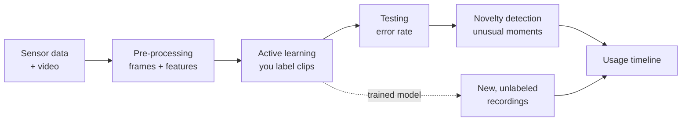

# Capstone AI IoT

**Turn motion-sensor recordings of a prototype into a timeline of how people actually used it.**

This repository contains the code of the **IoT ML Design Kit**: a Jupyter-based toolkit for designers who want to analyse prototype tests with accelerometer and gyroscope data instead of scrubbing through hours of video by hand. You record a user test with an IMU (for example a GoPro) and a video, label a small number of short clips, and the toolkit trains a model that classifies the rest of the recording for you.

It was built for designers and Industrial Design Engineering students with little or no programming experience, so the whole workflow runs from a single, step-by-step notebook. The aim is to connect low-level sensor data to what people actually do with an object "in the wild".

**User guide (separate repository):** https://datacentricdesign.github.io/iot-ml-design-kit/



## Contents

- [What it does](#what-it-does)
- [Requirements](#requirements)
- [Installation](#installation)
- [Quick start](#quick-start)
- [Input data format](#input-data-format)
- [Extracting GoPro telemetry](#extracting-gopro-telemetry)
- [Output](#output)
- [Troubleshooting](#troubleshooting)
- [Project structure](#project-structure)
- [Design decisions](#design-decisions)
- [Known limitations](#known-limitations)
- [Documentation](#documentation)
- [Credits](#credits)

---

## What it does

| Step | What happens | Where |
|---|---|---|
| 1. Pre-processing | Sensor data is cut into overlapping frames and 8 features are extracted per axis | `data_processing.py` |
| 2. Active learning | You label short video clips; the model picks the clips it is least sure about | `active_learning.py`, `Videolabeler.py` |
| 3. Testing | You label a held-out set so the tool can report an error rate | `active_learning.py` |
| 4. Novelty detection | The 10% most unusual frames are played back so you can spot unexpected use | `novelty_detection.py` |
| 5. Usage timeline | Percentages per action and a Gantt-style timeline of the whole recording | `data_stats.py` |
| 6. New data | Apply the trained model to new, unlabeled recordings | `Notebook.ipynb`, cell 12 |

### Under the hood

- **Features:** per sensor axis, minimum, maximum, mean, standard deviation, area under the curve, peak frequency, spectral centroid frequency and total spectral energy. With accelerometer and gyroscope combined this gives 48 features per frame. Features are standardised per feature type across axes.
- **Classifier:** a Random Forest. Its maximum depth is set from the average depth of an initial forest (x1.25) to limit overfitting while training on very few labels.
- **Active learning:** margin sampling. The base model is seeded with random frames (4 per label) plus the frame closest to each K-means cluster centre (about 1.5 clusters per label), so roughly 5.5 labels per class before active learning starts. Training stops after the set number of iterations or once the smallest margin exceeds 0.15.
- **Novelty detection:** Local Outlier Factor (20 neighbours) on the scaled features.

---

## Requirements

- Python **3.9 or newer** (the code uses built-in generic type hints such as `dict[str, float]`)
- Jupyter Notebook
- The packages in `requirements.txt`, plus `kaleido` for exporting the timeline images

The labeling and novelty players are HTML/JavaScript widgets rendered inside the notebook output. They have been used in the classic Jupyter Notebook interface; other front ends (JupyterLab, VS Code) may not run the embedded scripts, in which case the video will not play.

---

## Installation

```bash
git clone https://github.com/iantmn/Capstone-AI-IoT.git
cd Capstone-AI-IoT

python -m venv .venv
# Windows
.venv\Scripts\activate
# macOS / Linux
source .venv/bin/activate

pip install -r requirements.txt
pip install kaleido==0.2.1

jupyter notebook
```

Create the two output folders. They are not in the repository, and pre-processing and training fail without them:

```bash
mkdir Preprocessed-data Models
```

The clone is fairly large because it includes the example recordings and videos in `Data/`.

The step-by-step installation guide for students is here: https://datacentricdesign.github.io/iot-ml-design-kit/guide/installation_guide.html

---

## Quick start

1. Open **`Notebook_demo.ipynb`**. It is pre-filled with the example recording in `Data/data-mok/` (a mug: `Still`, `Pick_up`, `Put_down`, `Drinking`, `Walking`). Run it top to bottom once to get a feel for the workflow.
2. Open **`Notebook.ipynb`** for your own project and fill in, in order:
   - `Product`: a name using only letters, digits, `_` and `-`
   - `frame_size` and `frame_offset` (seconds)
   - the paths to your accelerometer CSV, gyroscope CSV and video
   - your expected `labels` and the number of `active_learning_iterations`
3. Label the clips that appear. At each prompt you can enter:

   | Input | Effect |
   |---|---|
   | `1`, `2`, ... or the label name | Assign that label |
   | `n` | Add a new label |
   | `x` | Discard this frame (ambiguous or faulty) |
   | `d` | Delete the previously labeled frame and redo it (one step back only) |

4. Run the testing, novelty detection and timeline cells to analyse the result.

### Choosing frame settings

| Setting | Guideline | Default |
|---|---|---|
| `frame_size` | About the length of one action. Larger for slow movements (cycling: ~5 s), smaller for quick ones (vacuuming: ~1 s) | 2 s |
| `frame_offset` | 10-20% of the frame size. Smaller means more frames: potentially a better model, but more labeling | 0.2 s |
| `start_offset` / `stop_offset` | Seconds to cut from the start/end of the recording | 0 |
| `video_offset` | Seconds the video runs before the sensor data starts | 0 |
| `skip_n_lines_at_start` | Header or junk lines to skip at the top of a data file | 0 |

### How much to label

Aim for 10-20% of the available frames, and at least 100. Cell 6 prints how many frames your data produced. For testing, label at least 20 frames and preferably around 50.

---

## Input data format

Each sensor file is comma-separated (`.csv` or `.txt`) with a time column followed by three data columns:

```
time_in_seconds, x, y, z
```

For example, the first lines of `Data/data-mok/Gijs_Mok_GH010035-ACCL.csv`:

```
0.0,9.437799043062201,0.17942583732057416,3.3636363636363638
0.005,9.490430622009569,0.18181818181818182,3.351674641148325
0.01,9.421052631578947,0.20574162679425836,3.3157894736842106
```

- No header row. If your file has header or junk lines at the top, skip them with `skip_n_lines_at_start`.
- The sampling frequency is derived from the first timestamps, so the recording must be sampled at a constant rate.
- Accelerometer and gyroscope data go in separate files. You can use either one or both; if you use both, list the accelerometer first.
- Example recordings are in `Data/` (mug, cycling, walking/stairs, vacuum cleaning).

See the [File Formatting Guide](https://datacentricdesign.github.io/iot-ml-design-kit/guide/fileformatting_guide.html) for details and the [Data Collection Guide](https://datacentricdesign.github.io/iot-ml-design-kit/guide/datacollection_guide.html) for how to record a good user test.

---

## Extracting GoPro telemetry

The example data was recorded with a GoPro, which stores accelerometer and gyroscope data inside the video file. The `GoPro/` folder contains a two-step converter.

1. **Extract the telemetry to JSON** (needs [Node.js](https://nodejs.org/)):

   ```bash
   cd GoPro
   npm install
   ```

   Edit `GoPro_Telemetry_Code.js`: set the path of your `.MP4` in `readFileSync(...)` and the output name in `writeFileSync(...)`, then run:

   ```bash
   node GoPro_Telemetry_Code.js
   ```

2. **Convert the JSON to CSV.** Edit `jsontocsv.py`: list your JSON files (without the `.json` extension) in `all_paths` and set `desired_data` to `"ACCL"` or `"GYRO"`. Run it once per sensor:

   ```bash
   python jsontocsv.py
   ```

   This writes `<name>-ACCL.csv` and `<name>-GYRO.csv` next to the JSON files, in the format the notebook expects.

Use the GoPro's low-resolution `*_LRV.mp4` file as the video in the notebook. It is small enough to play smoothly during labeling.

---

## Output

All output is written relative to the notebook:

| Path | Content |
|---|---|
| `Preprocessed-data/<Product>/features_<Product>.txt` | Raw features per frame |
| `Preprocessed-data/<Product>/features_<Product>_scaled.csv` | Standardised features |
| `Preprocessed-data/<Product>/features_<Product>_scaled_AL_predictionss.csv` | Every frame with its (labeled or predicted) action |
| `Preprocessed-data/<Product>/processed_data_files.txt` | Which frame IDs belong to which data and video file |
| `Models/model_<Product>_<iterations>.pickle` | The trained Random Forest |
| `Plots/distribution.png`, `Plots/distribution_all.png` | Usage timelines |

---

## Troubleshooting

| Problem | Fix |
|---|---|
| The install cell fails but shows nothing | Remove the `%%capture` line at the top of cell 1 and run it again to see the error |
| `Access is denied` / `WinError 5` while installing numpy | Another Python process holds the file. Close Jupyter, install from a terminal (or add `--user`) and restart |
| The kernel crashed | Restart it from the **Kernel** menu and re-run cells 2, 3, 4 and 7. Pre-processing and labeling only need to be redone if they had not finished |
| A cell seems stuck on `[*]` | It is probably waiting for input (a `y/n` question or a label). Scroll to the bottom of the cell output |
| `File at path ... does not exist` | Check the video path. Paths are relative to the notebook; keep the `r` in front of the quotes |
| `FILE CORRUPTED: cannot convert data to float` | The data file has header lines or a different layout. Set `skip_n_lines_at_start` or check the format above |
| `FileNotFoundError` for `Preprocessed-data/...` or `Models/...` | Create the folders: `mkdir Preprocessed-data Models` |
| The video does not play while labeling | Open the notebook in classic Jupyter Notebook and make sure the notebook is trusted |
| `NameError: active_learning_iterations is not defined` in the New Data cell | Run cell 7 first; the model filename depends on it |

---

## Project structure

```
Capstone-AI-IoT/
├── AI_for_Designers/              Core package used by the notebooks
│   ├── data_processing.py         Windowing, feature extraction, scaling
│   ├── active_learning.py         Active learning loop, testing, model export
│   ├── Videolabeler.py            In-notebook video player and label prompt
│   ├── novelty_detection.py       Outlier detection and playback
│   ├── data_stats.py              Label percentages and timeline charts
│   └── Notebook.py                Small helpers for the notebook
├── Notebook.ipynb                 Main notebook for your own data
├── Notebook_demo.ipynb            Pre-filled example run (mug dataset)
├── Notebook_user_test.ipynb       Version used during user testing
├── Instructions user test.docx    Script given to user-test participants
├── Data/                          Example recordings and videos
├── GoPro/                         GoPro telemetry extraction (Node.js + Python)
├── Plots/                         Flowchart images and generated plots
├── Training-and-tuning/           Model exploration and tuning experiments
│   ├── first_training.py          Compares KMeans, KNN, SVC, RF, ...
│   ├── first_training_mok.py      Same comparison on the mug dataset
│   ├── first_tuning.py            Grid search experiments
│   ├── plotting.py                Per-class accuracy plots
│   ├── kmean_accuracy_walking.ipynb  KMeans vs Random Forest
│   └── util.py                    Permutation feature importance
└── requirements.txt
```

`Preprocessed-data/` and `Models/` are created by you (see [Installation](#installation)) and filled by the notebook.

The scripts in `Training-and-tuning/` document how the model was chosen and are not needed to use the tool.

---

## Design decisions

The exploration scripts compared unsupervised K-means with several supervised models on a walking / running / stairs dataset. K-means separated walking and running well but struggled with stairs (best-case overall accuracy around 0.82, stairs down around 0.35), while the Random Forest scored far higher. Combined with its ability to output class probabilities for active learning, this made the Random Forest the model of choice.

Note that those comparisons used a random train/test split over overlapping frames, so neighbouring and near-identical frames end up on both sides of the split. The reported Random Forest accuracy (1.0) is therefore optimistic; a split by recording or by time block gives a more realistic estimate.

---

## Known limitations

- **Windows-style paths.** A few paths in the notebooks use backslashes (for example in the `SuperStandardScaler` call and the "New Data" cell). Replace them with forward slashes on macOS and Linux.
- **Version mismatch.** `requirements.txt` pins `numpy==1.24.1`, while the install cell in the notebooks pins `numpy==1.21.4`. Pick one; installing both in sequence can fail on Windows with a file-lock error. `kaleido` is only installed by the notebook cell.
- **Interactive prompts.** Pre-processing asks `y/n` before saving features, and labeling uses `input()`. The cell will wait until you answer.
- **Restarting training loses new labels** that you added with `n` during a previous run; add them to `labels` in cell 7 instead.
- **Timeline colours** are limited to 23 labels.
- **Multiple recordings** are stitched into one continuous timeline.
- **"New Data" cell in the demo** points to `GoPro\Gijs_Mok\...`, which is not in the repository. Point it to your own new recording (or to `Data/data-mok/` to try it out).
- **Hard-coded paths in `GoPro/`.** Both converter scripts have the input and output paths written in the code; edit them before each run.

---

## Documentation

| Page | Link |
|---|---|
| Background | https://datacentricdesign.github.io/iot-ml-design-kit/background/ |
| Installation Guide | https://datacentricdesign.github.io/iot-ml-design-kit/guide/installation_guide.html |
| Data Collection Guide | https://datacentricdesign.github.io/iot-ml-design-kit/guide/datacollection_guide.html |
| File Formatting Guide | https://datacentricdesign.github.io/iot-ml-design-kit/guide/fileformatting_guide.html |
| Preprocessing technicalities | https://datacentricdesign.github.io/iot-ml-design-kit/technicalities/preprocessing_technicalities.html |
| Active learning technicalities | https://datacentricdesign.github.io/iot-ml-design-kit/technicalities/activelearning_technicalities.html |
| Glossary | https://datacentricdesign.github.io/iot-ml-design-kit/glossary/ |

---

## Credits

Built for the **Capstone Applied AI project (TI3150)**, part of the Engineering with AI minor at TU Delft.

**Authors:** Alan Roukema, Gijs Volkers, Skip Doorn, Sophie Vlot, Ian Tiemann

**Clients:** Jacky Bourgeois, Dave Murray-Rust, Kostas Tsiakas
**Teaching assistant:** Matej Havelka

## License

_Add a license (for example MIT) before publishing._
